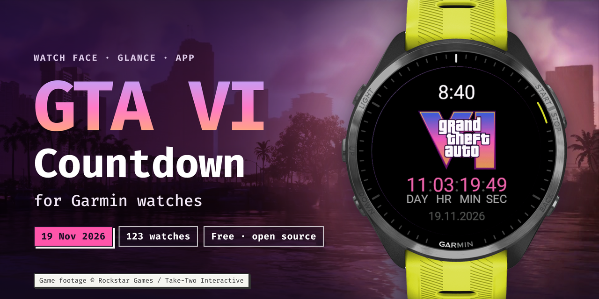
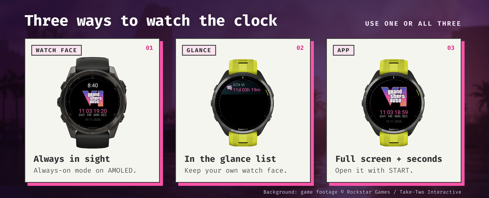
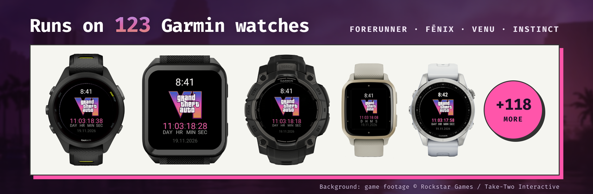

<p align="center">
  <a href="https://gta6-garmin.belidor.cc">
    
  </a>
</p>

<p align="center">
  <b>Count down to GTA VI on your Garmin watch.</b><br>
  A free watch face, glance and app that tick to <b>19 November 2026, 00:00</b> on your watch clock.
</p>

<p align="center">
  <a href="https://developer.garmin.com/connect-iq/"></a>
  <a href="#supported-watches"></a>
  <a href="LICENSE"></a>
  <a href="https://gta6-garmin.belidor.cc"></a>
</p>

<p align="center">
  <a href="https://gta6-garmin.belidor.cc"><b>Website</b></a>
  &nbsp;·&nbsp;
  <a href="https://gta6-garmin.belidor.cc/#install"><b>Install</b></a>
  &nbsp;·&nbsp;
  <b>Connect IQ Store:</b> coming soon
</p>

## What it is

- **A watch face** with the time, the GTA VI logo and a live countdown: days, hours, minutes and seconds. On AMOLED watches it dims to a quiet always-on mode.
- **A glance and a full-screen app.** Keep your favorite watch face and check `GTA VI · 11d 04h 18m` in the glance list. Open the app for big digits with seconds.
- **Launch day and after.** On 19 November it switches to **OUT NOW** and counts the days since release. No permissions, no phone, no internet: it is plain math on the watch clock.

<p align="center">
  
</p>

## Install

**Easiest way:** open **[gta6-garmin.belidor.cc/#install](https://gta6-garmin.belidor.cc/#install)**, pick your watch and download the files. Then copy them to the watch over USB. It takes about two minutes.

<p align="center">
  <a href="https://gta6-garmin.belidor.cc/#install">
    
  </a>
</p>

**Step by step:**

1. **Download.** Pick your watch on the site. Download the watch face, the app, or both. They are `.prg` files.
2. **Connect.** Plug the watch into your computer with the USB cable.
   - **Mac:** open the watch in [OpenMTP](https://openmtp.ganeshrvel.com/) (free). Older watches also show up in Finder as a drive.
   - **Windows:** open the watch in File Explorer.
3. **Copy.** Put the `.prg` file into the `GARMIN/Apps` folder on the watch.
4. **Unplug.** Eject the watch and unplug it. It installs the file in a few seconds.
5. **Turn it on.**
   - **Watch face:** on most watches hold **UP** or **MENU**, choose **Watch Face**, then **GTA VI Countdown**.
   - **Glance:** at the end of the glance list choose **Edit**, then **Add**.
   - **App:** press **START** and pick **GTA VI Countdown**.

> [!NOTE]
> **Connect IQ Store: coming soon.** Garmin reviews every store app, and that takes a few days. When the store version is out, first delete the sideloaded `.prg` from `GARMIN/Apps`, then install from the store. This way you do not get two copies.

Prefer GitHub? The `.prg` files for every watch will also be on the [Releases](https://github.com/Belidor/gta6-countdown/releases) page.

## Supported watches

<p align="center">
  
</p>

123 Garmin models with Connect IQ 3.0 or newer and a color screen: Forerunner, fēnix, epix, Enduro, Venu, vívoactive, Instinct 3 AMOLED, MARQ, D2, Descent and Approach. Click your watch family to see the models.

<!-- watches:start -->
<details>
<summary><b>Forerunner</b> · 23 models</summary>

- Forerunner 70
- Forerunner 165
- Forerunner 165 Music
- Forerunner 170
- Forerunner 170 Music
- Forerunner 245 <sub>no glance</sub>
- Forerunner 245 Music <sub>no glance</sub>
- Forerunner 255
- Forerunner 255 Music
- Forerunner 255s
- Forerunner 255s Music
- Forerunner 265s
- Forerunner 570 42mm
- Forerunner 570 47mm
- Forerunner 645 <sub>no glance</sub>
- Forerunner 645 Music <sub>no glance</sub>
- Forerunner 745 <sub>no glance</sub>
- Forerunner 935 <sub>no glance</sub>
- Forerunner 945 <sub>no glance</sub>
- Forerunner 945 LTE <sub>no glance</sub>
- Forerunner 955 / Solar
- Forerunner 965
- Forerunner 970

</details>

<details>
<summary><b>fēnix · epix · Enduro</b> · 39 models</summary>

- Enduro <sub>no glance</sub>
- Enduro 3
- Enduro 4
- epix Pro (Gen 2) 42mm
- epix Pro (Gen 2) 47mm / quatix 7 Pro
- epix Pro (Gen 2) 51mm / D2 Mach 1 Pro / tactix 7 – AMOLED Edition
- fēnix 5 / quatix 5 <sub>no glance</sub>
- fēnix 5 Plus <sub>no glance</sub>
- fēnix 5S <sub>no glance</sub>
- fēnix 5S Plus <sub>no glance</sub>
- fēnix 5X / tactix Charlie <sub>no glance</sub>
- fēnix 5X Plus <sub>no glance</sub>
- fēnix 6 / 6 Solar / 6 Dual Power <sub>no glance</sub>
- fēnix 6 Pro / 6 Sapphire / 6 Pro Solar / 6 Pro Dual Power / quatix 6 <sub>no glance</sub>
- fēnix 6S / 6S Solar / 6S Dual Power <sub>no glance</sub>
- fēnix 6S Pro / 6S Sapphire / 6S Pro Solar / 6S Pro Dual Power <sub>no glance</sub>
- fēnix 6X Pro / 6X Sapphire / 6X Pro Solar / tactix Delta Sapphire / Delta Solar / Delta Solar - Ballistics Edition / quatix 6X / 6X Solar / 6X Dual Power <sub>no glance</sub>
- fēnix 7 / quatix 7
- fēnix 7 Pro
- fēnix 7 Pro - Solar Edition (no Wi-Fi)
- fēnix 7S
- fēnix 7S Pro
- fēnix 7X / tactix 7 / quatix 7X Solar / Enduro 2
- fēnix 7X Pro
- fēnix 7X Pro - Solar Edition (no Wi-Fi)
- fēnix 8 43mm
- fēnix 8 47mm / 51mm / tactix 8 47mm / 51mm / quatix 8 47mm / 51mm
- fēnix 8 Pro 47mm / 51mm / MicroLED / quatix 8 Pro 47mm / 51mm
- fēnix 8 Solar 47mm
- fēnix 8 Solar 51mm / tactix 8 Solar 51mm
- fēnix 9 43mm
- fēnix 9 47mm / 51mm
- fēnix 9 Pro 43mm
- fēnix 9 Pro 47mm
- fēnix 9 Pro 51mm
- fēnix 9 Pro Solar 47mm
- fēnix 9 Pro Solar 51mm
- fēnix Chronos <sub>no glance</sub>
- fēnix E

</details>

<details>
<summary><b>Venu</b> · 14 models</summary>

- Venu <sub>no glance</sub>
- Venu 2
- Venu 2 Plus
- Venu 2S
- Venu 3
- Venu 3S
- Venu 4 41mm
- Venu 4 45mm / D2 Air X15
- Venu Mercedes-Benz Collection <sub>no glance</sub>
- Venu Sq <sub>no glance</sub>
- Venu Sq 2
- Venu Sq 2 Music
- Venu Sq. Music Edition <sub>no glance</sub>
- Venu X1

</details>

<details>
<summary><b>vívoactive</b> · 8 models</summary>

- vívoactive 3 <sub>no glance</sub>
- vívoactive 3 Mercedes-Benz Collection <sub>no glance</sub>
- vívoactive 3 Music <sub>no glance</sub>
- vívoactive 3 Music LTE <sub>no glance</sub>
- vívoactive 4 <sub>no glance</sub>
- vívoactive 4S <sub>no glance</sub>
- vívoactive 5
- vívoactive 6

</details>

<details>
<summary><b>Instinct</b> · 3 models</summary>

- Instinct 3 AMOLED 45mm
- Instinct 3 AMOLED 50mm
- Instinct Crossover AMOLED

</details>

<details>
<summary><b>MARQ</b> · 11 models</summary>

- MARQ (Gen 2) Athlete / Adventurer / Captain / Golfer / Carbon Edition / Commander - Carbon Edition
- MARQ (Gen 2) Aviator
- MARQ (Gen 3) Athlete / Adventurer / Aviator / Commander / Golfer / Diver
- MARQ Adventurer <sub>no glance</sub>
- MARQ Athlete <sub>no glance</sub>
- MARQ Aviator <sub>no glance</sub>
- MARQ Captain / MARQ Captain: American Magic Edition <sub>no glance</sub>
- MARQ Commander <sub>no glance</sub>
- MARQ Driver <sub>no glance</sub>
- MARQ Expedition <sub>no glance</sub>
- MARQ Golfer <sub>no glance</sub>

</details>

<details>
<summary><b>D2 · Descent · Approach · Legacy editions</b> · 25 models</summary>

- Approach S50
- Approach S62 <sub>no glance</sub>
- Approach S70 42mm
- Approach S70 47mm
- Approach S72 43mm
- Approach S72 47mm
- Captain Marvel <sub>no glance</sub>
- D2 Air <sub>no glance</sub>
- D2 Air X10
- D2 Charlie <sub>no glance</sub>
- D2 Delta <sub>no glance</sub>
- D2 Delta PX <sub>no glance</sub>
- D2 Delta S <sub>no glance</sub>
- D2 Mach 1
- D2 Mach 2
- D2 Mach 2 Pro
- Darth Vader <sub>no glance</sub>
- Descent G2
- Descent Mk1 <sub>no glance</sub>
- Descent Mk2 / Mk2i <sub>no glance</sub>
- Descent Mk2 S <sub>no glance</sub>
- Descent Mk3 43mm / Mk3i 43mm
- Descent Mk3i 51mm
- First Avenger <sub>no glance</sub>
- Rey <sub>no glance</sub>

</details>

The glance needs Connect IQ 4.0 or newer. On the 52 watches marked <sub>no glance</sub>, open the app from the apps list instead. The watch face and the app work on all 123.
<!-- watches:end -->

## FAQ

**Is this an official Rockstar Games app?**<br>
No. It is an unofficial fan project. It is not affiliated with or endorsed by Rockstar Games or Take-Two Interactive.

**Does it drain the battery?**<br>
No more than a regular digital watch face. It redraws once a minute and shows seconds only while your wrist is up. In always-on mode it lights a few pixels and moves them every minute against burn-in.

**What happens on 19 November?**<br>
At 00:00 on your watch clock, in your time zone, the countdown turns into **OUT NOW**. Then it counts the days since launch; day one is launch day. Store unlock times can differ by region.

**What if the release date moves again?**<br>
The date gets updated in a new version. The Connect IQ Store version (coming soon) will update by itself. For a sideloaded copy, download the new file from the site.

**What about my privacy?**<br>
The watch face and the app ask for no permissions, make no network requests and collect no data. The website counts visits with Google Analytics only if you allow it. Read the [privacy policy](https://gta6-garmin.belidor.cc/#privacy).

**My watch is not on the list.**<br>
Open an [issue](https://github.com/Belidor/gta6-countdown/issues) with the exact model name, or write to [belidor@icloud.com](mailto:belidor@icloud.com).

## For developers

| Folder | What it is |
|---|---|
| [`watchface/`](watchface) | Watch face: time, logo, countdown, AMOLED always-on mode |
| [`app/`](app) | Watch app: a glance for the glance list and a full-screen view with seconds |
| [`landing/`](landing) | Static website. [`.github/workflows/pages.yml`](.github/workflows/pages.yml) deploys it to https://gta6-garmin.belidor.cc when a push to `main` changes `landing/` |
| [`promo/`](promo) | Images and text for the announcement |
| [`store/`](store) | Connect IQ Store screenshots, icon and listing text |
| [`.github/readme/`](.github/readme) | Banners for this README. HTML sources and scripts are in `src/` |

### Build

You need the [Connect IQ SDK](https://developer.garmin.com/connect-iq/sdk/) from the SDK Manager. `build.sh` reads the SDK path from the SDK Manager settings on macOS.

```bash
cd watchface          # or: cd app
./build.sh            # .prg for Forerunner 965
./build.sh fenix7     # .prg for another device
./build.sh products   # refresh the device list from the SDK Manager downloads
./build.sh export     # .iq package for every device in manifest.xml
```

The files go to `bin/`. To test on a real watch, copy a `.prg` to `GARMIN/Apps` and unplug the watch.

> [!IMPORTANT]
> On the first run `build.sh` creates a signing key in `keys/`. The folder is in `.gitignore`. Keep a private backup of it: every Connect IQ Store update must be signed with the same key.

### Release date

The date is at the top of three files. Change all three:

- [`watchface/source/GTA6CountdownView.mc`](watchface/source/GTA6CountdownView.mc): `RELEASE_YEAR`, `RELEASE_MONTH`, `RELEASE_DAY`
- [`app/source/Countdown.mc`](app/source/Countdown.mc): the same three constants
- [`landing/main.js`](landing/main.js): `RELEASE`, the website countdown

### README banners

- `.github/readme/src/render.sh` renders the banners from HTML to PNG. It needs Google Chrome and ffmpeg.
- `python3 -I .github/readme/src/watch_list.py` refreshes the watch list above from [`landing/install/devices.json`](landing/install/devices.json).
- `hero.png` is 1280×640, so it also works as the GitHub social preview (Settings → General → Social preview).

## Legal

- Unofficial fan project. Not affiliated with or endorsed by Rockstar Games or Take-Two Interactive.
- Grand Theft Auto, GTA VI and the GTA VI logo are trademarks of Take-Two Interactive Software, Inc.
- Game footage and images © Rockstar Games / Take-Two Interactive. The banners and the website use frames from the official GTA VI launch trailer.
- Garmin, Forerunner, fēnix, Venu, vívoactive, Instinct, MARQ and Connect IQ are trademarks of Garmin Ltd. or its subsidiaries.
- The [MIT license](LICENSE) covers the code only. It does not cover the GTA VI logo or the game imagery.

<p align="center">
  Made by <a href="https://github.com/Belidor">Belidor</a> · <a href="mailto:belidor@icloud.com">belidor@icloud.com</a> · <a href="https://github.com/Belidor/gta6-countdown/issues">Issues</a>
</p>
